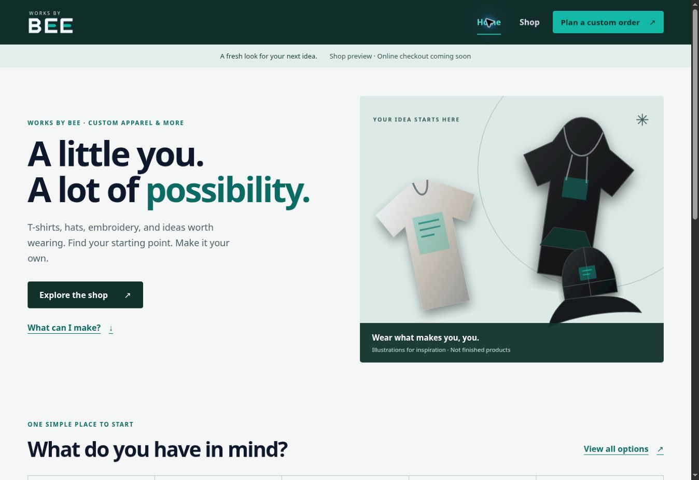

# Works by BEE: storefront review and launch plan

## Decision

Make Home and Shop the primary public experience. Preserve the platform rather than replace the repository. The previous main commit, `d86fae57bab7d3d7f5879260173b902af7349ef7`, is preserved on `archive/pre-storefront-2026-10-28`. Studio, saved drafts, the bag, staff routes and server protections remain in the project; customer tools are secondary navigation.

## Current-state audit before changes

Reviewed the live homepage and `/shop`, the current main source, package scripts, CI, metadata generation, Worker deployment configuration, intake documentation, and the two layout references (The Kut Shoppe and VanillaBeamsTV).

- The homepage led with quote requests, groups, creators and process explanations across seven content sections. This communicated a custom-project platform rather than a simple product storefront.
- Shop was absent from desktop primary navigation and called “Future collections” in secondary navigation. The shop itself was an empty launch notice plus links back into Studio.
- The existing dark/blue palette did not reflect the selected gray/teal reference.
- The existing artwork is garment illustration, not photography of actual finished work. No approved portfolio photos or reviews were found in the supplied material.
- There are no published sellable SKUs, verified prices, stock or checkout provider integration. `wrangler.jsonc` has intake disabled. The live homepage also states that online requests are unavailable.
- The code already has useful safeguards: lazy Studio/Fabric loading, local draft recovery, quote status verification, separate staff authentication, a skip link and native-dialog mobile navigation. Preserve those strengths.
- Baseline verification: 13 test files / 87 tests passed; TypeScript and production build passed. Shared CSS was 13.96 kB gzip; the JS entry was 67.62 kB gzip. Google Fonts added an external stylesheet dependency.

## Amanda's requirements mapped to implementation

| Request | Release decision |
| --- | --- |
| Simple homepage, not overwhelming | Short hero, category links, one concise introduction, planned collections |
| Quick overview like VanillaBeamsTV | Plain-language description, one primary shop action, no long process/filler stack |
| Service tabs like The Kut Shoppe | Large product-category links and filter buttons using familiar labels |
| T-shirts, hats, decals, embroidery | First-class categories; hoodies also included from the reference and existing work |
| Phone-first and usable by older relatives | Home/Shop always visible; large tap targets; readable type; native disclosures; explicit action labels |
| Gray-and-teal reference | Deep green/charcoal `#12312B`, teal `#14B8A6`, white, gray `#E1E5E9`, ink `#0F172A`; darker teal `#0B6B63` for accessible small text |
| Slideshow of actual work/reviews eventually | Manual, non-autoplay gallery component ready for approved photography. Hidden when empty. No invented reviews. |
| Cars/computers/healthcare and holidays | Clearly labeled planned collections, without invented stock or release dates |
| Square/Shopify for commerce | Future integration milestone; no dummy payment flow or false purchase success |
| Gang sheets, T-shirt bar, pop-ups | Later operational offerings; do not advertise as available before equipment, pricing and event details are confirmed |

The mockup's PC-component imagery is treated as visual inspiration, not proof that BEE sells hardware. No hardware catalog was invented.

## Layout and behavior

Home: compact launch status → hero and shop action → product categories → short BEE overview → future collections → concise footer. A finished-work gallery appears only after approved content is added.

Shop: page introduction → concise availability notice → category controls → product-type ideas with expandable details → custom-planner handoff. Categories persist in the URL and respond to browser history. Unknown categories safely show all options. Cards are planning ideas, not inventory: no fake prices, discounts, stock counts, review stars or add-to-cart buttons.

The planner can prefill a recognized item from a shop link. Existing draft garments are retained rather than silently overwritten. Saved designs and Studio remain accessible under Project tools. The brand mark's geometry is retained with a teal accent.

## Performance and accessibility work

- Removed the remote font stylesheet and used system fonts.
- Reused small local SVG garment illustrations and adapted them to the chosen palette. Explicit dimensions reserve space; below-fold shop images use lazy loading.
- Kept Fabric and Studio split from storefront routes.
- Added repeatable gzip-size budgets to `npm run check`: 85 kB initial JS per storefront route, 20 kB shared CSS, 15 kB total storefront illustrations. These are asset budgets, not Lighthouse scores or field Core Web Vitals.
- Added axe-core WCAG A/AA structural checks for Home/Shop with shared header/footer. jsdom does not render layout, so its contrast rule is disabled; explicit color-pair checks and browser inspection cover separate concerns.
- Contrast checks require at least 4.5:1 for normal-text design pairs. The initial teal-on-gray pairing measured 4.32:1 and was corrected to darker teal.
- Keyboard-visible focus, native category buttons with pressed state, polite result announcements, native details/summary controls, native modal Escape/focus restoration, no autoplay, and reduced-motion support.
- Narrow layout testing found and removed a global minimum width causing horizontal overflow. Mobile menu branding was simplified and project tools collapsed. Menu dismissal on resize now matches the actual 761px desktop breakpoint.

## Second review and release acceptance

The new experience makes the supported customer task clear: browse a product type and plan an idea. Home and Shop are first-class navigation on desktop and phones. No tools, server configuration, saved customer data, authentication or payment settings were removed or activated.

The requested website direction is implemented. A sales-ready store remains dependent on business inputs below. Do not interpret a live frontend as operational payment or request intake.

Local release verification: all 107 tests across 15 files passed, including two axe-core page checks and 12 text-contrast pairs. Frontend/server TypeScript and the production build passed. Final gzip budgets: homepage JS 69,853 bytes; shop JS 69,649 bytes; shared CSS 16,240 bytes. All five storefront SVGs total 5,309 uncompressed bytes. The shared CSS grew by about 2.3 kB gzip to avoid destabilizing retained project pages; removing unused legacy style rules can be a separate cleanup.

Browser review: desktop Home/Shop; Home at phone and tablet sizes; Shop at 320, 390, 820 and 1024 pixel frames. Shop scroll width equaled available viewport width at each size; filter targets measured 48px tall. The desktop viewport also had no horizontal overflow. Verified category selection, changing results, a product-to-planner handoff with “Hats” prefilled, mobile menu opening, Escape dismissal and focus return. Browser logs showed extension metadata errors only, not application errors. Frame-based responsive checks are not physical-device Safari testing.

Automated checks and visual review are not a full assistive-technology audit, checkout acceptance test or Lighthouse/Core Web Vitals measurement. No such certification or score is claimed. Remote CI and Cloudflare production deployment must be verified after the main update.

## Next launch dependencies, in order

1. BEE supplies approved product photography/artwork, product names, variants, actual prices, fulfillment details and policies. Replace concept illustrations with actual product photos for live SKUs.
2. Select the primary commerce catalog/checkout provider and grant appropriate development access. If both Shopify and Square are used, decide which system owns products, inventory, orders and refunds before syncing anything.
3. Configure server-side credentials, verified checkout URLs and webhook verification. Test variant selection, stock, tax, shipping, checkout cancellation, order confirmation, duplicate webhook handling and refunds in the provider's test environment.
4. Activate a verified business contact channel and/or the existing protected intake setup. Test a complete request-to-response workflow before advertising online submission.
5. Add approved finished-work images to `workPhotos` in `src/content/storefront.ts`. Obtain permission for customer images and quotes before publication.
6. Add seasonal collections when actual products exist. Add transfers/gang sheets and T-shirt-bar events only once service specifications and operations are ready.
7. Continue advanced Studio development independently from storefront launch priorities.

## Rollback

Use the archive branch to inspect the previous state. Prefer reverting the storefront release commit on main and letting the existing Cloudflare integration redeploy. Do not force-rewrite main. The archive is a source checkpoint. The existing Cloudflare integration automatically creates branch previews; that does not change the production domain.
