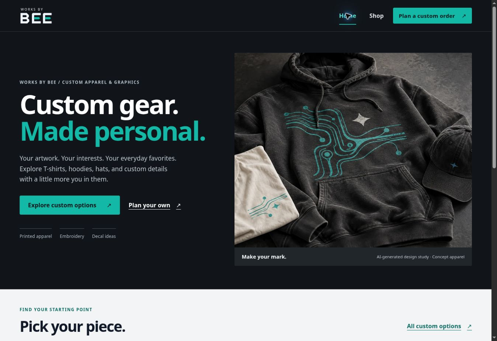

# BEE character and customer-flow refinement

Builds on 86ae456. The Square account has not been created or confirmed, so commerce is not activated.

## What changed

The homepage uses a charcoal/graphite hero, teal actions and a tactile apparel design study. Category shortcuts include small garment visuals. The copy leads with custom apparel and graphics. Unavailable future collections were removed from the main presentation; current launch availability is explained once at the bottom. Shop uses the same charcoal introduction, neutral product surfaces and concrete garment labels.

The custom-order planner, project review, bag and checkout placeholder share light customer-facing surfaces and matching controls. The planner links back to the shop. Existing draft protection, request status checks and unavailable-payment behavior are retained.

## Image provenance

`public/storefront/apparel-study.webp` is an AI-generated fictional apparel concept made with the built-in image-generation tool. It is visibly labeled on Home and is not presented as actual BEE customer work, inventory or an available product. Owner-approved finished-product photos should replace concept imagery as the catalog becomes available.

Prompt used: product-mockup editorial hero for Works by BEE, landscape 3:2; a washed charcoal hoodie, folded off-white T-shirt and charcoal cap on a graphite surface; realistic cotton grain, seams, ribbed cuffs, print texture and embroidery; original teal abstract circuit-trace artwork and a small geometric star; premium independent print-shop aesthetic with a technical edge; charcoal #0F172A, gray #E1E5E9, teal #14B8A6 and off-white; no people, machinery, text, logos, watermarks, UI or neon glow. The artwork is a design study.

The generated source is retained in the working assets. The project uses an optimized 1400×933 WebP (188,636 bytes); the asset budget is 220 kB. No image-generation service is called by site visitors.

## Square handoff

[Owner setup guide](../operations/square-owner-setup.md). The guide covers BEE ownership, developer application setup, Sandbox identifiers/server secrets, authentication choices, initial test product and release acceptance. It does not imply an account connection exists. No Square scripts, merchant credentials, payment requests or live charges are introduced by this release.

## Validation

Type checks, 109 tests across 15 files, build and asset budgets pass. Automated accessibility coverage includes Home/Shop structure and 14 text contrast pairs. This is not a full screen-reader or physical-device audit. Browser review verified Home, Shop and the custom-order planner on desktop and at 320, 390 and 820 pixel frames. Each measured scroll width matched the available viewport. A low-contrast legacy planner link was found and corrected. These frame checks do not replace physical-device Safari testing. Remote CI and live deployment are checked after the main update.
