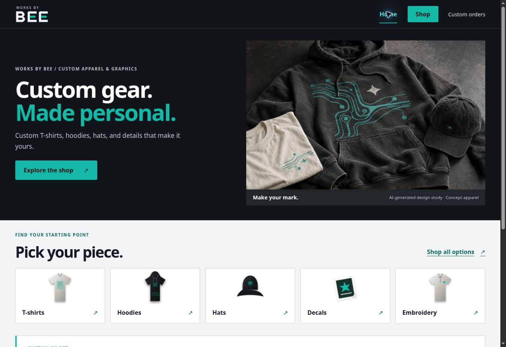
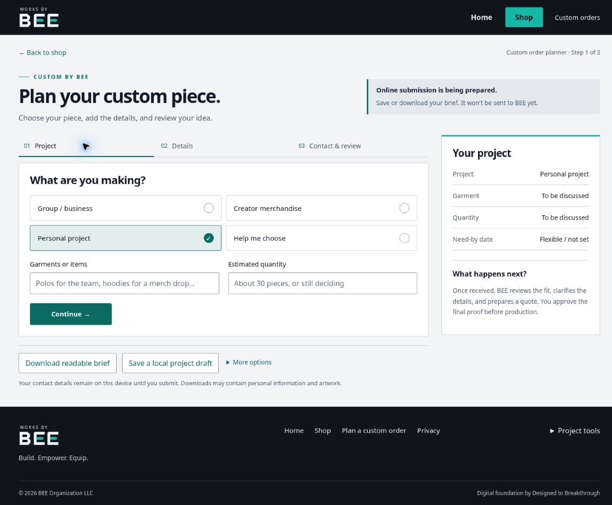

# BEE layout and shopping hierarchy — 29 October 2026

## Finding and direction

The supplied desktop screenshot exposed a 1240px content cap, an oversized two-line planner introduction, and a full-width availability notice above the form. These decisions left broad side gutters and delayed the first useful controls. The next release should give the existing content a clear grid and a stronger shopping hierarchy.

Home is the front door to Shop. Custom planning remains a secondary path. Square's account is being created by BEE; this release does not connect a seller or enable transactions.

## Shipped layout

- Header, content sections, and planner share a responsive grid: up to 1600px on desktop and 1760px on displays at least 2000px wide. Gutters scale with the viewport; phone gutters remain 18px.
- Shop is the highlighted navigation action. The homepage hero has one primary action, a shorter introduction, a bounded image height, compact category cards, and a smaller custom-project callout.
- Shop has a shorter introduction and availability notice. Six option cards form a balanced three-column desktop grid, then two columns and one column. Card actions align across each row.
- The planner puts its introduction beside the notice, groups the initial fields, and uses check marks for selection. Group-size help appears for group projects; empty attached-design links are omitted. The JSON export remains available under More options.
- Existing artwork, saved drafts, review steps, intake protections, category URLs, and product preselection are retained.

## Validation

`npm run check` passed: frontend/server TypeScript, 110 tests in 15 files, production build, metadata, and asset budgets. Automated axe structural checks cover Home, Shop, and the planner; 14 explicit foreground/background pairs pass 4.5:1 contrast. These are targeted checks, not a claim of full WCAG certification or a Lighthouse score.

Rendered browser checks covered 320, 390, 820, 1024, 1440, 1920, and 2560px frames on Home, Shop, and the planner. No horizontal overflow remained, including the narrow phone header. The frame's classic scrollbar reduces available width by 15px where needed.

At 1920px the shared content is 1600px wide; at 2560px it is 1760px. On a 390px phone frame the homepage categories begin around 695px down the document. The desktop planner's form begins around 362px down the document, with the summary beside it. Readable line lengths and control grouping take priority over filling every pixel.

Manual interactions verified Home → Shop, planner advancement by mouse and keyboard, preserved sample details in review, focus on the new step heading, disabled online submission, and mobile-menu Escape/focus restoration. Temporary QA files were removed before the final production build.

Production gzip bytes: Home initial JavaScript 69,542; Shop initial JavaScript 69,525; shared CSS 17,154. Hero image 188,636 bytes, unchanged. No new dependency, external font, or initial Fabric download was added.

## Review evidence

Screenshots show the verified local release before publication:

## Remaining integration

After the BEE-owned Square account is available, connect the catalog, item variations, authoritative prices/availability, checkout, and signed payment events using the existing Square plan. Keep the present layout shell and category routes coherent with that data. Do not turn concept illustrations into purchasable stock or enable payment without real catalog data and sandbox verification.
